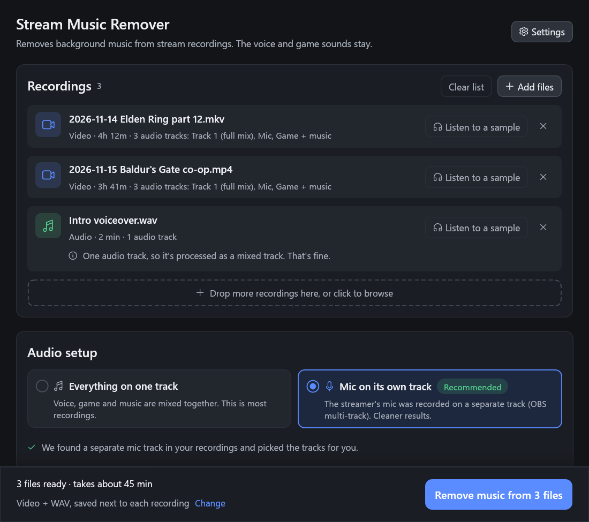

# Stream Music Remover

Removes the background music from stream recordings. Your voice and the game sounds stay.

## How to use it

1. **Download** `StreamMusicRemover.exe` with the button above and open it.
   Windows may show "Windows protected your PC" the first time. Click **More info**, then **Run anyway**.
2. **Click "Set up now".** The app downloads what it needs (about 4 GB) and sets itself up.
   This takes 5 to 15 minutes and only happens once.
3. **Drag your recordings into the window** and click **Remove music**.

The new files are saved next to each recording, with "(no music)" in the name. Your originals are never changed.

## What you need

- Windows 10 or 11
- About 8 GB of free disk space
- An NVIDIA graphics card, for speed. Without one the app still works, but a one-hour recording can take four hours or more.

## Good to know

- **Not sure how it will sound?** Click **Listen to a sample** on a recording to hear 30 seconds with the music removed first.
- **Recorded your mic on its own track in OBS?** The app notices and uses it, which gives a cleaner result.
- **To remove the app**, delete `StreamMusicRemover.exe` and the folder `%LOCALAPPDATA%\StreamMusicRemover`.

## Credits

The music removal is done by the Bandit v2 model from "Remastering Divide and Remaster" by Karn Watcharasupat, Chih-Wei Wu and Iroro Orife ([model weights](https://zenodo.org/records/12701995), CC BY-SA 4.0). The model code comes from [MSST-WebUI](https://github.com/SUC-DriverOld/MSST-WebUI) (AGPL-3.0), and video and audio files are handled by [ffmpeg](https://ffmpeg.org). The app downloads all three during setup.

## Licence

The app's own code is under the [MIT License](LICENSE). The licences of the libraries built into it, and of everything setup downloads, are listed in [THIRD-PARTY-NOTICES.txt](THIRD-PARTY-NOTICES.txt).
